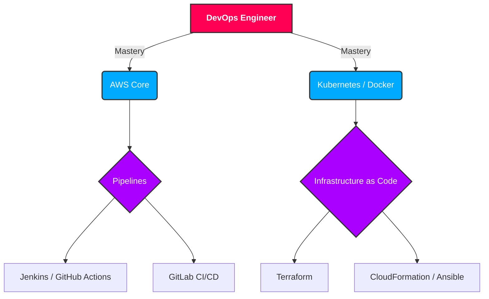

# < Shailendra />

### `> initiating_protocol: PROFILE_VIEW`
### `> access_level: PUBLIC`
### `> user_detected: SHAILENDRA`
### `> role: DevOps Engineer | Cloud Architect`
### `> status: ONLINE`

 

---

## 📟 System Status

> "Automating the cloud, one pipeline at a time."

I am a passionate **DevOps Engineer** based in **Noida, India**, with over **3.8 years of experience** in automating, optimizing, and maintaining scalable cloud infrastructure and CI/CD pipelines. I specialize in **AWS**, **Docker**, **Kubernetes**, **Jenkins**, and **Terraform**, aiming to improve deployment efficiency and reduce downtime.

- 🌱 **Current Operation**: Architecting robust **Kubernetes clusters** and scalable environments.
- ⚡ **Fun Fact**: `echo "Automate all the things!"`

---

## 📂 Mission Log (Experience)

### 🛡️ **Operation: Enterprise Infrastructure**
**Role:** DevOps Engineer @ *NTT Data*
**Timeline:** `Aug 2022 - Present`
> - **Orchestrated** CI/CD pipelines using Jenkins, Git, and GitHub Actions, significantly reducing manual effort and deployment time.
> - **Deployed** Kubernetes (EKS) clusters for scalable microservices architecture across multiple enterprise clients including Abrigo, Schlumberger (SLB), and Mitchell International.
> - **Provisioned** AWS-based infrastructure (EC2, RDS, S3, VPC, CloudWatch, Lambda, IAM) using CloudFormation for secure and scalable deployments.
> - **Automated** routine tasks with Python scripts & Ansible playbooks, and integrated monitoring using Prometheus, Grafana, and ELK Stack.

---

## 🌳 Skill Progression Tree

---

## 🚀 Deployed Artifacts (Projects)

### 🔄 **Operation: CI/CD Pipeline Automation**
*Jenkins | GitHub Actions | Docker | Kubernetes | SonarQube*
> Built end-to-end CI/CD pipelines reducing deployment time by **40%** and enabling zero-downtime blue-green deployments.
> - **Containerization**: Orchestrated 10+ microservices on Kubernetes (EKS), achieving **99.9%** uptime across environments.
> - **Security & Quality**: Integrated SonarQube gates, OWASP checks, and automated rollbacks on failed health checks.
> - **Timeline**: `Jan 2024 - Present`

### 🕸️ **Operation: Kubernetes Cluster Infrastructure**
*AWS EKS | Helm | Prometheus | Grafana*
> Designed and deployed a production-grade Kubernetes cluster on AWS EKS with auto-scaling, ingress controllers, and persistent storage.
> - **Deployment & Security**: Implemented Helm charts for deploying apps and configured RBAC policies for least-privilege access.
> - **Observability**: Set up Prometheus and Grafana monitoring with PagerDuty alerting, reducing mean time to detect (MTTD) by **60%**.
> - **Timeline**: `Mar 2023 - Dec 2023`

---

## 🛠️ Tech Arsenal

| Class | Modules |
| :--- | :--- |
| **Cloud Platforms** |   |
| **DevOps Tools** |      |
| **IaC & Automation** |     |
| **Monitoring** |    |
| **Core** | Linux (Ubuntu/CentOS), Basic Networking, Firewalls, DNS |

---

## 🎓 Academic Archives (Education)

- 📜 **Bachelor of Science (PCM)** - *Chhatrapati Shahu Ji Maharaj University, Kanpur, India* (`2019 - 2022`)
  - **Relevant Skills**: Cloud Computing, Linux Administration, Networking, Scripting with Python and Bash

 

## 📊 RPG Stats (Telemetry)

  
  

   
  

---

  <h3>✨ End of Transmission ✨</h3>

